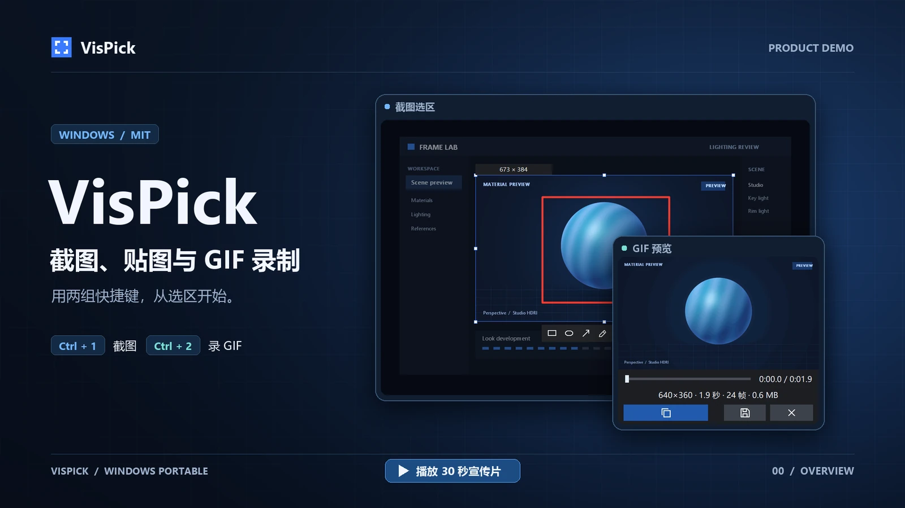
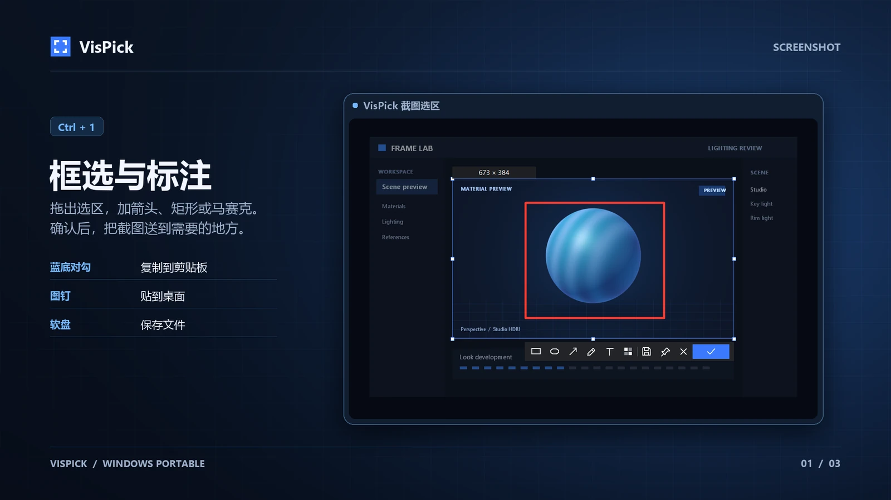
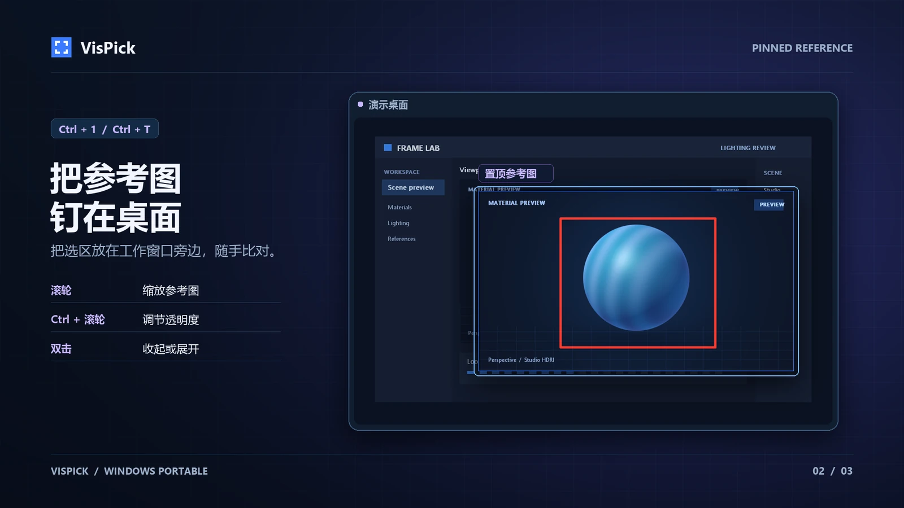
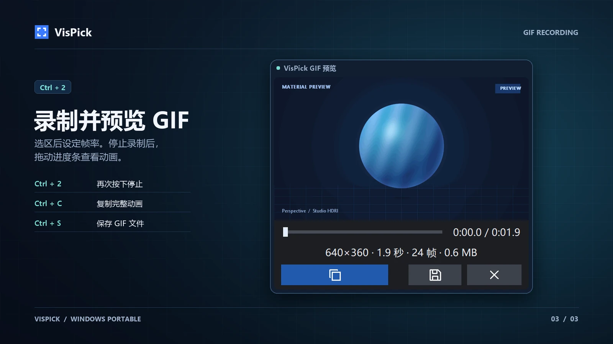

# VisPick

面向 Windows 的便携截图、参考图和 GIF 工具。

最新版本为 **0.6.0**，面向 Windows 11 x64，Release 只提供一个独立的 `VisPick.0.6.0.exe`，下载后直接运行。x86 继续保留源码构建和 CI 验证。 [下载 VisPick 0.6.0.exe](https://github.com/1031193940/VisPicker/releases/download/v0.6.0/VisPick.0.6.0.exe) · [发布说明](https://github.com/1031193940/VisPicker/releases/tag/v0.6.0)

双架构构建、静态分析和各 321 项单元测试已通过；部分前景/生命周期、双 4K 性能和 GIF 原型验收仍未通过。完整范围见 [0.6.0 发布说明](https://github.com/1031193940/VisPicker/releases/tag/v0.6.0)。Win10、Win7、干净系统、完整物理多屏兼容矩阵和第三方软件粘贴仍待验证。

## 使用

以下流程对应 0.6.0。升级时先保存需要保留的参考图和 GIF，从托盘退出旧版，将新 exe 放到原目录并运行，保留原有 `VisPick.ini` 即可继续使用自定义设置。若曾启用开机自启，请在新版托盘菜单中关闭再开启一次，以更新启动路径。

双击 `VisPick.0.6.0.exe`，程序进入托盘并显示启动通知。Release 不附带配置文件；首次启动生成带中文注释的 `VisPick.ini`，exe 所在目录不可写时使用 `%APPDATA%\VisPick\VisPick.ini`。编辑配置并保存后自动生效，不需要重启，也不会覆盖你的注释。

默认保留启动提醒和错误通知，成功操作静默。重复启动会重放运行提醒，启动时汇总热键冲突；GIF 错误显示在预览状态栏。`[General] Notify=errors` 为默认策略，`all` 也显示已有信息通知，`none` 只保留启动提醒。Windows 勿扰或系统通知设置可能影响气泡呈现。

热重载时，删除某个配置键会沿用本次运行中的有效值。恢复单项默认值可以将模板中的默认值填回该键。

| 操作 | 快捷键与流程 |
|---|---|
| 截图 | Ctrl+1 打开截图。拖出选区或单击窗口，按需调整和标注 |
| 复制截图 | 点选区工具条上的蓝底对勾，也可按 Enter 或双击选区 |
| 保存截图 | 点软盘图标，选择文件位置与格式 |
| 参考图 | 点图钉图标，把截图和标注钉在原位置 |
| GIF | Ctrl+2 → 选区 → 选帧率，再点圆点或按 Enter 开始。双竖线暂停、三角形继续；Ctrl+2 或方块停止并打开预览 |
| GIF 预览 | 拖动进度条定位，空格播放/暂停；`[` / `]` 设首尾，Ctrl+R 重置。软盘保存、双页复制当前片段 |
| 调整选区 | 拖动内部、8 个手柄；方向键移动，Ctrl+方向键调整右/下边界；加 Shift 变为 10 px |
| 显示器 / 窗口 | Ctrl+A 选择鼠标所在显示器；Tab / Shift+Tab 切换顶层窗口候选 |
| 取色 | C 复制冻结画面的 HEX，Shift+C 复制 RGB；文字输入时原生编辑框优先 |
| 标注 | R 矩形、E 椭圆、A 箭头、P 画笔、T 文字、M 马赛克；再次点击工具取消选择 |
| 编辑输出 | Ctrl+Z / Ctrl+Y 撤销重做。Ctrl+C 复制，Ctrl+S 保存，Ctrl+T 贴图 |
| 取消 | 点叉号或按 Esc 取消选区。文字输入时 Esc 结束文字输入。录制请点工具条的取消按钮 |

截图和 GIF 的操作按钮只显示图标。悬停可查看动作名称和可用的快捷键。

截图保存支持 PNG/JPG/BMP。截图剪贴板先提供含透明度的 DIBV5 和白底 DIB，后台再补充 PNG；后续复制已改变剪贴板时丢弃过期 PNG。PNG 保留像素和透明度。文件编码在后台进行，失败不会截断已有目标文件。

GIF 帧率选择仅用于本次录制。可通过 `[Gif] Fps` 设置默认帧率。录制满五分钟自动停止，暂停时间不计入时长，旧配置中的 `[Gif] MaxSeconds` 会被忽略。临时 GIF 位于 `%TEMP%\VisPick`，保存或确认放弃后清理，启动时清理一天前本程序遗留的录制。

`[Gif] Scale` 设置输出缩放上限。大选区超过编码内存预算时，VisPick 会按比例降低输出分辨率，保留整个选区。预览显示 GIF 的实际像素尺寸。

预览里点左下角的蓝色双页图标，或按 Ctrl+C，复制当前保留片段；未裁剪时复制完整动画。粘贴效果取决于目标应用是否接受 GIF 数据或 GIF 文件。超过 64 MiB 的录制以文件形式提供。

预览中用起点/终点图标或 `[` / `]` 按显示帧设置保留范围，Ctrl+R 恢复全片。裁剪会重新合成和编码，可能影响颜色和文件大小；未裁剪时保留原文件字节。导出失败后原录制仍可重试。

如果 Windows 暂时无法自动激活选区，浮层会显示拖选提示。直接拖动鼠标即可选择区域，右键可以取消。

录制不占用全局 Esc。录制达到 3 秒后，点取消会先停止并打开预览，可以保存或确认放弃。旧系统在全屏录制时可能隐藏工具条，此时按 GIF 热键停止。`[Advanced] CaptureLayeredGif=true`（旧键 `capture_layered_gif` 仍兼容）可启用分层窗口采集，默认关闭。

参考图操作：

| 操作 | 效果 |
|---|---|
| 拖动 / 方向键 / Shift+方向键 | 移动 / 1 px / 50 px；靠近屏幕或其他参考图吸附 |
| 双击 | 在光标处收缩为方块，再次双击恢复；收缩时 Esc / Enter 恢复 |
| 滚轮 / Shift+滚轮 | 以光标为中心缩放；默认 10% / 1% |
| Ctrl+滚轮 | 调整透明度 |
| Alt+上下 / Alt+Shift+上下 | 缩放 ±10% / ±1% |
| Alt+左右 / Alt+Shift+左右 | 透明度 ±10% / ±1% |
| 5–9 / 0 | 缩放到 50%–90% / 100% |
| R / Alt+H / Alt+V | 顺时针 90° / 水平翻转 / 垂直翻转 |
| Ctrl+C / Ctrl+X / Ctrl+V / Ctrl+S | 复制 / 剪切 / 剪贴板新贴图 / 保存 |
| Esc 或 Q / Ctrl+Z | 关闭入回收站 / 恢复最近关闭；默认保留 5 张 |

右键参考图可设置缩放、透明度、置顶和鼠标穿透。托盘菜单可隐藏/显示全部、关闭全部、恢复最近关闭，并解除所有参考图的鼠标穿透。参考图与回收站仅保留在本次进程中。

参考图默认留在创建它的 Windows 虚拟桌面，使用 Ctrl+Win+方向键切换桌面时不会跟随。右键托盘 →「参考图」→ 勾选「参考图跨桌面」，可让所有参考图在各个桌面显示。取消勾选后恢复由 Windows 管理的单桌面显示，已经隐藏的参考图仍保持隐藏。开关立即生效，并保存为 `[Pin] AcrossDesktops=true/false`，重启后保留。

默认全局热键为 Ctrl+1 截图和 Ctrl+2 GIF。可在 `[Hotkeys]` 中修改热键或留空禁用。升级前先退出托盘中的旧进程，再启动新版 exe。新版会忽略旧配置 `[Hotkeys]` 段的 `Pin` 项，因此原来的 Ctrl+3 绑定会释放。托盘的「截取参考图」和 `--pin` 仍可直接打开贴图选区，该入口支持 `Pin.Instant=true` 松手即贴。

注册失败时，其余热键照常工作。可右键托盘打开「关于」，查看未注册的按键和失败原因。被其他程序占用的热键会自动重试，对方释放后即可使用。

默认关闭日志和自启。自启仅修改当前用户的 VisPick Run 项。完整配置模板见 [0.6.0 default.ini](https://github.com/1031193940/VisPicker/blob/v0.6.0/res/default.ini)。

```powershell
& ".\VisPick.0.6.0.exe" --screenshot
& ".\VisPick.0.6.0.exe" --pin-file "D:\Pictures\参考.png"
& ".\VisPick.0.6.0.exe" --pin-clipboard
& ".\VisPick.0.6.0.exe" --toggle-pins
& ".\VisPick.0.6.0.exe" --reload
& ".\VisPick.0.6.0.exe" --exit
# 指定已有或待创建的配置文件；已运行实例不会悄悄切换配置
& ".\VisPick.0.6.0.exe" --config "D:\Tools\VisPick.ini"
```

同一用户会话只运行一个实例，重复启动转发命令。`--perf` 本次运行启用诊断日志；`--help` / `--version` 单独使用，不启动常驻实例。应用无网络上传或联网依赖。

## 产品演示

用 30 秒看完 VisPick 0.5.9 的截图标注、桌面贴图和 GIF 录制。点击封面打开 MP4。界面来自 VisPick，画面中的 Frame Lab 是自制演示工作台。

[](docs/media/vispick-promo.mp4)

| 截图与标注 | 桌面贴图 | GIF 录制与预览 |
|---|---|---|
| [](docs/media/vispick-screenshot.webp) | [](docs/media/vispick-pin.webp) | [](docs/media/vispick-gif.webp) |

## 开发与限制

用户说明对应 0.6.0。逐项改动、验证结果和后续事项见 [本轮实施记录](docs/reviews/Implementation-Optimization-2026-11-10.md)。

构建、测试、CI 和打包步骤见 [开发文档](docs/DEVELOPMENT.md)；平台覆盖见 [已知限制](docs/KNOWN_ISSUES.md)。产品源码没有直接网络请求或上传逻辑；网络路径及系统组件行为见 [代码审计](docs/reports/P6-code-audit.md)。

## 许可证

VisPick 项目代码采用 MIT 许可证。 [LICENSE](LICENSE)

第三方依赖和测试素材沿用各自的许可证。 [测试依赖说明](tests/third_party/README.md) · [测试素材许可](docs/reports/data/quality-input/README.md)
